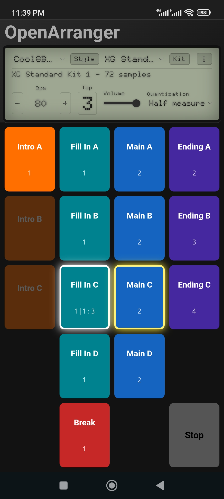

# OpenArranger

Ferramenta de acompanhamento musical open-source, web-based e offline-first para performances ao vivo — agora com **gravação e exportação MIDI**.

## Sumário

- [Visão Geral](#visão-geral)
- [Principais Recursos](#principais-recursos)
- [Gravação e Exportação MIDI](#gravação-e-exportação-midi)
- [ReSync](#resync)
- [Kit de Som (`.kit`)](#kit-de-som-kit)
- [Estilo (`.style`)](#estilo-style)
- [Boas Práticas para Criação de Estilos](#boas-práticas-para-criação-de-estilos)
- [Licença e Créditos](#licença-e-créditos)

## Visão Geral

O OpenArranger emula teclados arranjadores físicos no navegador, com **zero latência de áudio** e funcionamento **100% offline** (PWA). Projetado para músicos solo que tocam ao vivo, permite o controle em tempo real de padrões de bateria não-lineares (Mains, Fills, Intros, Endings, Breaks) — e agora também **grava e exporta sua performance como MIDI quantizado**.

[](screenshot.jpg)

## Principais Recursos

- **Interface focada em performance:** grade vertical ampla e ergonômica, otimizada para dispositivos móveis em ambiente de palco
- **Quantização dinâmica:** transições no grid (compassos inteiros, metade ou ¼)
- **ReSync:** corrige o compasso ao vivo com um toque, sem parar a música e sem mexer no BPM
- **Motor de ritmo duplo:** canais independentes para Ritmo Principal e Sub-Ritmo, cada um com seleção de kit e controle de volume
- **Motor de áudio com zero latência:** Web Audio API sincronizado
- **Feedback visual e tátil:** botões antecipam a seção de destino; vibração confirma comandos (Android)
- **Gravação ao vivo em MIDI:** registre toda a sua performance e exporte como arquivo `.mid` quantizado, com BPM e fórmula de compasso preservados (inclusive compassos curtos do ReSync)
- **Reprodutor interno:** ouça a última gravação instantaneamente sem sair do app
- **Padrões abertos:** arquivos MIDI, SFZ e JSON legíveis e editáveis
- **Arquitetura desacoplada:** kits e estilos são intercambiáveis

## Gravação e Exportação MIDI

O OpenArranger inclui um **gravador de performance integrado**, acessível por dois botões no cabeçalho:

- **Gravar:** arma a gravação, que começa no próximo início de compasso (ou junto com o Start, se a música estiver parada). Com a gravação em andamento, tocar no botão encerra e exporta o arquivo `.mid` sem interromper a música.
- **Tocar gravação:** reproduz a última gravação com os kits carregados, sem sair do app.

O arquivo exportado é um MIDI Format 1 com:

- **Conductor:** mudanças de BPM e fórmula de compasso (inclusive os compassos curtos criados pelo [ReSync](#resync)).
- **Rhythm** e **SubRhythm:** uma track para cada canal, com as notas quantizadas no grid.

Mudanças de BPM feitas durante a gravação respeitam a quantização escolhida, para que o tempo gravado caia no grid junto com as notas.

## ReSync

Botão grande (embaixo, entre o Break e o Start) que corrige o compasso ao vivo, sem parar a música e sem mexer no BPM — útil quando a cantora entra errada ou a música quebra o compasso (ex.: um 2/4 no meio de um 4/4).

- A bateria termina o tempo atual e o próximo tempo vira o "1" de um compasso novo; o corte respeita o grid (sempre um número inteiro de tempos).
- Apertar no tempo 1, 2 ou 3 gera um compasso de 1, 2 ou 3 tempos (1/4, 2/4, 3/4). Apertar no último tempo não faz nada.
- BPM e seção não mudam. Se houver Fill, Break ou Ending enfileirado, ele entra no novo "1".
- Em seções com vários compassos, o compasso cortado conta como concluído e a música segue para o próximo; cortando o último, vale o fim normal da seção.
- Em compassos compostos, o corte acontece no pulso definido por `beatUnit` (ex.: `"4."` em 6/8 gera 2 pulsos). Sem `beatUnit`, vale a semínima.
- Na gravação MIDI, o compasso curto aparece de verdade: o arquivo registra a nova fórmula no início dele e a volta à fórmula original no compasso seguinte. Cada corte gera seu par de trocas; se dois cortes seguidos caem no mesmo instante, vale a última fórmula.

**Observações**

- O corte considera o tempo que você *ouve* (com a latência de saída do áudio descontada), não o que o app já agendou.
- Notas já agendadas no áudio não podem ser recolhidas: se você apertar nos últimos ~100 ms de um tempo, o corte vai para o tempo seguinte. Se esse for o último tempo, o botão não faz nada e a barra de status avisa.
- O ReSync só funciona com a música tocando.

## Kit de Som (.kit)

Um Kit de Som é um arquivo `.zip` renomeado para `.kit`.

Sua estrutura deve conter um ou mais arquivos `.sfz` na raiz e uma única pasta `Samples/` contendo todos os arquivos WAV utilizados.

```
Sounds.kit
├── DrumKit.sfz
├── PercussionKit.sfz
└── Samples/
    ├── 36 Kick.wav
    ├── 37 Side Stick.wav
    └── ...
```

Quando um kit possui vários arquivos SFZ, o OpenArranger disponibiliza um seletor independente para cada canal:

- **Rhythm** (bateria principal)
- **Sub Rhythm** (percussão)

Isso permite combinar diferentes kits durante a execução.

### Opcodes SFZ suportados

#### `<control>`

- `default_path`

#### `<global>`

- `loop_mode`

#### `<group>`

- `group`
- `off_by`

#### `<region>`

- `key`
- `sample`

### Exemplo

```sfz
<control> default_path=Samples/

<global> loop_mode=one_shot

<region> key=36 sample=36 Kick.wav
<region> key=37 sample=37 Side Stick.wav
<region> key=38 sample=38 Snare.wav
<region> key=39 sample=39 Hand Clap.wav
<region> key=40 sample=40 Snare Tight.wav
<region> key=41 sample=41 Floor Tom L.wav
<region> key=42 sample=42 Hi-Hat Closed.wav group=1 off_by=1
<region> key=43 sample=43 Floor Tom H.wav
<region> key=44 sample=44 Hi-Hat Pedal.wav group=1 off_by=1
<region> key=45 sample=45 Low Tom.wav
<region> key=46 sample=46 Hi-Hat Open.wav group=1 off_by=1
```

---

## Estilo (.style)

Um Estilo é um arquivo `.zip` renomeado para `.style`.

Ele deve conter exatamente:

- um arquivo `.mid`;
- um arquivo `.json`;

ambos na raiz do arquivo.

```
MyStyle.style
├── style.mid
└── style.json
```

Os nomes dos arquivos não importam; o OpenArranger identifica cada arquivo apenas pela extensão.

É possível carregar vários estilos simultaneamente e alternar entre eles através da interface.

Sempre que um novo estilo é selecionado, sua execução começa na **Intro A**.

---

## Arquivo MIDI

O arquivo MIDI deve ser do **Tipo 0**.

Pode conter um ou mais canais. Normalmente utiliza-se:

- Canal 10 para bateria;
- Canal 9 para percussão.

Entretanto, qualquer canal pode ser utilizado desde que seja informado corretamente no `style.json`.

### Informações ignoradas

O OpenArranger **não utiliza** informações presentes no arquivo MIDI como:

- BPM;
- Time Signature;
- Markers;
- Program Change;
- Control Change.

Essas informações devem ser definidas no arquivo `style.json`.

---

## style.json

| Campo | Tipo | Obrigatório | Descrição |
|-------|------|-------------|-----------|
| `name` | string | ✓ | Nome do estilo |
| `timeSignature` | array | ✓ | Ex.: `[4,4]`, `[6,8]` |
| `bpm` | number | ✓ | Andamento inicial |
| `rhythmChannel` | number | ✓ | Canal MIDI da bateria |
| `subRhythmChannel` | number | ✓ | Canal MIDI da percussão |
| `sections` | object | ✓ | Mapeamento das seções |
| `beatUnit` | string ou number | | Unidade da pulsação em compassos compostos |

### Exemplo

```json
{
  "name": "16BeatBallad",
  "timeSignature": [4, 4],
  "bpm": 60,
  "rhythmChannel": 10,
  "subRhythmChannel": 9,
  "sections": {
    "Main A": { "startBar": 2, "endBar": 6 },
    "Main B": { "startBar": 6, "endBar": 10 },
    "Main C": { "startBar": 10, "endBar": 14 },
    "Main D": { "startBar": 14, "endBar": 18 },
    "Fill In A": { "startBar": 18, "endBar": 19 },
    "Fill In B": { "startBar": 19, "endBar": 20 },
    "Fill In C": { "startBar": 20, "endBar": 21 },
    "Fill In D": { "startBar": 21, "endBar": 22 },
    "Intro A": { "startBar": 22, "endBar": 23 },
    "Intro B": { "startBar": 23, "endBar": 25 },
    "Intro C": { "startBar": 25, "endBar": 29 },
    "Ending A": { "startBar": 29, "endBar": 31 },
    "Ending B": { "startBar": 31, "endBar": 33 },
    "Ending C": { "startBar": 33, "endBar": 36 },
    "Break": { "startBar": 36, "endBar": 37 }
  }
}
```

---

### beatUnit

Em compassos compostos (`6/8`, `9/8`, `12/8` etc.), o campo `beatUnit` define qual é a unidade da pulsação.

| Valor  | Significado       |
|--------|-------------------|
| `4`    | Semínima (padrão) |
| `8`    | Colcheia          |
| `"4."` | Semínima pontuada |
| `2`    | Mínima            |

Exemplo:

```json
{
  "name": "Ballad",
  "timeSignature": [6, 8],
  "beatUnit": "4.",
  "bpm": 72
}
```

Quando omitido, o OpenArranger assume `4`.

O `beatUnit` também define o pulso usado pelo [ReSync](#resync): em `6/8` com `"4."`, o compasso tem 2 pulsos e o corte gera um compasso de 3/8.

---

## Boas práticas para criação de estilos

- Utilize **Markers** na DAW para facilitar futuras edições, mesmo que o OpenArranger os ignore.
- Recomenda-se que **Fills** e **Breaks** tenham apenas um compasso.
- **Intros** e **Endings** podem ter qualquer duração.
- As seções **Main** funcionam melhor com dois ou mais compassos, embora um compasso também seja permitido.
- Para um resultado mais natural, coloque o prato de ataque no último instante do compasso anterior, com duração mínima, criando a sensação de que ele ocorre no início do compasso seguinte.

---

## Licença e Créditos

Este projeto é distribuído sob a Licença MIT.

Veja o arquivo **LICENCE**.

### Créditos

- Utilitário de ícones maskable por NotWoods
- JSZip